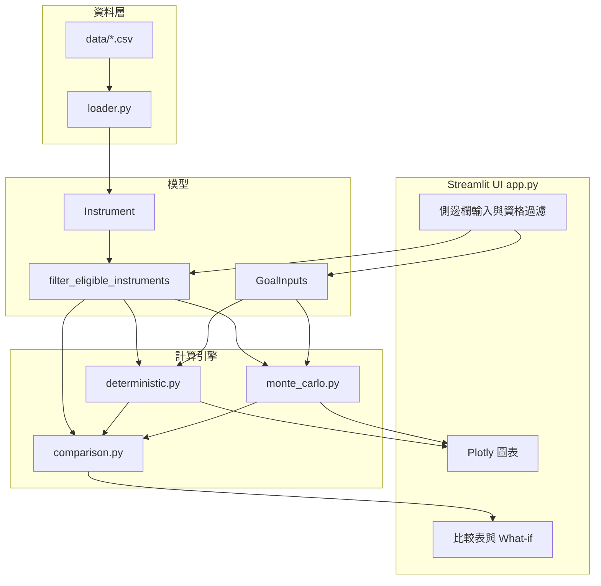

# GoalWise HK 系統與方法說明（繁體中文）

**GoalWise HK** 是 COMP5513 Financial Computing 專題的香港家庭儲蓄／投資目標規劃儀表板。  
它不只估算「大概何時達標」，更用蒙地卡羅估計「在期限內達標的機率有多高」，並比較本地低風險零售工具。

> **免責聲明**：本系統僅供課程教育與分析，**不是**個人化投資建議，也不執行任何交易。利率與 CPI 為整理過的示範資料，決策前請向銀行及政府債券計劃核實最新條款。系統不儲存個人財務資料。

---

## 目錄

1. [程式目標與定位](#1-程式目標與定位)
2. [技術堆疊與如何啟動](#2-技術堆疊與如何啟動)
3. [整體架構與資料流](#3-整體架構與資料流)
4. [使用者介面（`app.py`）](#4-使用者介面apppy)
5. [資料層（`src/data/loader.py`）](#5-資料層srcdataloaderpy)
6. [資料模型（`src/models/instruments.py`）](#6-資料模型srcmodelsinstrumentspy)
7. [確定性引擎（`src/engines/deterministic.py`）](#7-確定性引擎srcenginesdeterministicpy)
8. [蒙地卡羅引擎（`src/engines/monte_carlo.py`）](#8-蒙地卡羅引擎srcenginesmonte_carlopy)
9. [工具比較與 What-if（`src/engines/comparison.py`）](#9-工具比較與-what-ifsrcenginescomparisonpy)
10. [教育說明層（`src/education.py`）](#10-教育說明層srceducationpy)
11. [輸出指標解讀](#11-輸出指標解讀)
12. [測試覆蓋](#12-測試覆蓋)
13. [證據產物與文件](#13-證據產物與文件)
14. [專案檔案結構](#14-專案檔案結構)
15. [一句總結](#15-一句總結)
16. [附錄：主要函式速查](#16-附錄主要函式速查)

---

## 1. 程式目標與定位

香港家庭常有明確的港幣目標（例如置業首期、婚禮、學費），但銀行計算機通常假設：

- 每月固定供款
- 利率固定不變
- 沒有突發開支

真實生活卻有供款波動、通脹變化、再投資風險。GoalWise HK 因此做兩層分析：

| 層次 | 回答的問題 |
|------|------------|
| **確定性推估** | 若一切按計劃、利率固定，最終餘額是多少？每月要存多少才夠（名義／實質目標）？多久達標？ |
| **蒙地卡羅模擬** | 考慮不確定性後，達標的**機率**是多少（名義目標與通脹調整後目標）？若失敗，平均還差多少？標準誤多大？ |

比較對象為五項示範低風險零售工具：**HSBC Everyday Global Savings**、**港元定期存款 24 個月**、**iBond**、**銀色債券**、**零售綠色債券**（各自獨立比較，不混合配置）。  
介面會依**年齡／是否香港居民**過濾資格；銀色債券通常要求 60 歲或以上，iBond／綠色債券要求香港居民身分。

---

## 2. 技術堆疊與如何啟動

| 套件 | 用途 |
|------|------|
| **Streamlit** | 網頁儀表板 UI |
| **NumPy** | 向量化蒙地卡羅模擬 |
| **Pandas** | CSV 載入、比較表 |
| **Plotly** | 扇形圖、直方圖、長條圖 |
| **pytest** | 單元測試 |

啟動（Windows 建議）：

```bash
py -3 -m venv .venv
.\.venv\Scripts\python.exe -m pip install -r requirements.txt
.\.venv\Scripts\streamlit.exe run app.py
```

瀏覽器開啟 Streamlit 顯示的網址（通常為 `http://localhost:8501`）。

匯出固定種子模擬證據、重跑測試紀錄：

```bash
py -3 -m pytest -q
py -3 scripts/export_fixed_seed_results.py
```

---

## 3. 整體架構與資料流



執行順序（按「Run planner」後）：

1. 依年齡／居民身分過濾工具，組裝 `GoalInputs`（目標、期限、供款、通脹、波動參數、路徑數、隨機種子）
2. 對**聚焦工具**跑 `project_deterministic` 與 `run_monte_carlo`
3. 對**資格內工具**跑 `compare_instruments`（比較時路徑數上限 2,500，加快回應）
4. 對聚焦工具跑 `what_if_adjustments`
5. 在畫面顯示名義／實質成功機率、SE、圖表、比較表與情境分析

---

## 4. 使用者介面（`app.py`）

### 4.1 側邊欄輸入

**目標區塊**

| 輸入 | 說明 | 預設例 |
|------|------|--------|
| Goal amount | 目標金額（港元） | HK$400,000 |
| Deadline (years) | 期限年數，滑桿步進 **0.5 年**（轉成月：×12，例如 4.5 年 → 54 個月） | 4 年 |
| Current savings | 現有儲蓄 | HK$50,000 |
| Planned monthly saving | 計劃每月供款 | HK$6,000 |
| Assumed annual inflation | 假設年通脹（%） | 歷史 CPI 均值 |

**資格區塊（Eligibility）**

| 輸入 | 說明 | 預設 |
|------|------|------|
| Hong Kong resident | 是否香港居民（零售政府債券通常要求） | 是 |
| Age | 年齡（銀色債券通常要求 60+） | 35 |

不符合資格的工具會從「聚焦工具」下拉與比較表中排除，並在畫面上列出被排除名稱。

**不確定性區塊**

| 輸入 | 說明 | 預設 |
|------|------|------|
| Monte Carlo paths | 模擬路徑數：1,000 / 2,500 / 5,000 / 10,000 | 5,000 |
| Contribution variability | 供款對數常態波動 σ | 0.15 |
| Monthly expense-shock probability | 每月突發開支發生機率 | 0.05 |
| Focus instrument | 聚焦分析的單一工具（已過濾） | 列表中某一項 |

突發開支金額分布在程式內固定為：均值 HK$5,000、標準差 HK$2,000（可在 `GoalInputs` 看到）。隨機種子固定為 `seed=42`，同一組輸入可重現結果；結果區會顯示 seed 與路徑數。

### 4.2 未按執行時的首頁

顯示「How it works」、名義／實質成功機率、DPS、蒙地卡羅（含比例標準誤）的教育說明，以及**資格過濾後**的工具一覽表。

### 4.3 執行後的結果區

針對聚焦工具：

1. **主要 KPI**：名義成功機率、實質目標成功機率、期望短缺、期望終值  
2. **二項 SE**：名義與實質成功機率的 \(\sqrt{\hat p(1-\hat p)/N}\)，以及確定性投影  
3. **扇形圖**：第 10／50／90 百分位餘額路徑 + 目標水平線  
4. **終值直方圖**：所有路徑最終餘額分布  
5. **確定性路徑 vs 蒙地卡羅中位路徑**折線圖  
6. **實質投影、名義／實質達標所需月供、確定性達標月數**；其下有一行 caption 顯示**通脹後等值目標（Inflated goal）**  
7. **保障標籤**與該工具類別的教育說明  
8. **資格內工具比較表**（含名義／實質 P(success)、SE、實質目標所需月供等）+ 成功機率長條圖  
9. **What-if 表**：多存／延長期限對成功機率的影響  
10. **Learn more** 展開區：更完整的教育文案（含資格說明）

圖表以港元標示，金額格式為 `HK$…`。

**通脹後目標在畫面上怎麼出現（易漏看）：**

- 引擎**每次執行都會計算** `inflated_target`（為保住今天購買力，未來需要達到的港元金額）。  
- **不是**上方主 KPI 大格；主要顯示為：  
  1. 「Required monthly (real goal)」那一排**下方的灰色 caption**（`Inflated goal preserving today's purchasing power: HK$…`）；  
  2. `P(success) real target` 旁 **ⓘ tooltip**（內含 `inflated goal`）。  
- 扇形圖／直方圖／確定性對照圖上的 **Goal 虛線用的是名義目標**（側邊欄輸入的金額，例如 HK$400,000），**不是**通脹放大後的門檻。

---

## 5. 資料層（`src/data/loader.py`）

資料目錄：`data/`。欄位定義見 [`docs/data_dictionary.md`](docs/data_dictionary.md)。

| 檔案 | 內容 |
|------|------|
| `savings_rates.csv` | 本建置一筆：**HSBC Everyday Global Savings** |
| `time_deposits.csv` | 本建置一筆：**港元定期存款 24 個月**（含 `tenor_months`） |
| `bonds.csv` | 本建置三筆：iBond／銀色債券／零售綠色債券（含 `coupon_type`、`min_rate`） |
| `cpi_hk.csv` | 香港綜合消費物價指數示範序列（`yoy_inflation`） |

### 5.1 載入與驗證

- 檢查必要欄位是否存在
- 驗證 `instrument_id`、`source`、`as_of_date` 非空
- 年利率、`min_rate` 須在 \([0, 0.2]\)
- `tenor_months`、`min_deposit_hkd` ≥ 0
- CPI 的 `yoy_inflation` 不可有缺值

### 5.2 主要函式

| 函式 | 作用 |
|------|------|
| `load_all_instruments()` | 合併儲蓄 + 定存 + 債券 |
| `get_inflation_history()` | 回傳歷史 YoY 通脹列表（供 bootstrap） |
| `get_mean_inflation()` | 歷史通脹均值（側邊欄預設值） |

這些數字是**課程用示範資料**，每列都有來源與 as-of 日期，方便查核。

---

## 6. 資料模型（`src/models/instruments.py`）

### 6.1 `Instrument`（金融工具）

主要欄位：

- `annual_rate`：公告／示範年利率
- `tenor_months`：鎖定年期（0 表示儲蓄類、無鎖定）
- `protection`：`DPS_800k`（存款保障）或 `sovereign`（政府主權）
- `coupon_type` / `min_rate`：通脹掛鈎債券用

**有效年利率** `effective_annual_rate(inflation)`：

- 若為通脹掛鈎（`inflation_linked` / `inflation_linked_min`）：  
  \(\max(\texttt{min\_rate},\ \texttt{inflation})\)
- 否則：直接用 `annual_rate`

**等價月利率**（線上引擎使用的有效月利率）：

\[
r_{\text{月}} = (1 + r_{\text{年}})^{1/12} - 1
\]

意義：一年複利十二次後，等於該年利率。  
例如年利率 3.6% → 月利率約 0.295%，則一個月的本利和倍數為 `1 + 月利率` ≈ 1.00295。

### 6.2 資格規則

| 屬性／函式 | 說明 |
|------------|------|
| `requires_hk_resident` | `ibond`／`silver_bond`／`green_bond` 為 True |
| `min_age` | 銀色債券為 60；其餘為無 |
| `is_eligible(age, hk_resident)` | 判斷用家是否可買此工具 |
| `filter_eligible_instruments(...)` | 依側邊欄設定過濾清單 |

### 6.3 `GoalInputs`（使用者目標與模擬假設）

包含目標金額、期限月數、現有儲蓄、月供、年通脹，以及蒙地卡羅參數：供款波動、突發開支機率／均值／標準差、路徑數、隨機種子。

### 6.4 保障說明

- **DPS**：香港存款保障計劃，每存戶每銀行最高 **HK$800,000**（自 2024 年 10 月起由 50 萬上調）
- **Sovereign**：特區政府零售債券的主權信用（不是 DPS 存款保障）

---

## 7. 確定性引擎（`src/engines/deterministic.py`）

假設：利率固定、每月底固定供款、無突發開支、月複利。

### 7.1 複利慣例（重要）

| 用途 | 月利率／通脹折現 | 說明 |
|------|------------------|------|
| **線上引擎／UI** | \(r=(1+R)^{1/12}-1\) | 有效月利率；`real_value`、`inflated_target` 同此慣例 |
| **進度報告 Table 4 基準** | \(r=R/12\) | 名義月利率；由 `nominal_monthly_rate`、`nominal_real_value` 重現，見 `tests/test_report_benchmark.py` |

兩套數字不應混用；報告基準測試鎖定獨立計算的已知答案（例如年回報 2%、48 個月、月供 HK$6,500 時 FV ≈ HK$378,698.98）。

### 7.2 終值（Future Value）

設：

- \(P\) = 現有本金  
- \(C\) = 每月供款  
- \(r\) = 月利率  
- \(n\) = 月數  

\[
FV = P(1+r)^n + C\frac{(1+r)^n - 1}{r}
\]

若 \(r \approx 0\)，則退化解為 \(FV = P + C\cdot n\)。

第一項是本金複利成長；第二項是普通年金（每月底供款）的終值。

### 7.3 達標所需每月供款

反解年金公式：在 \(n\) 個月內要達到目標 \(G\)，需要的 \(C\)。  
若本金複利後已 ≥ 目標，則所需月供為 0。

UI 另會對**通脹後目標** \(G_{\text{inflated}} = G\cdot(1+i_{\text{月}})^n\) 再算一次所需月供（實質購買力目標）。

### 7.4 達標所需月數

在 \(r > 0\) 且 \(C > 0\) 時用對數封閉解：

\[
(1+r)^n \ge \frac{G\cdot r + C}{P\cdot r + C}
\]

向上取整為月數；超過上限（預設 600 個月）視為無法達標。特殊情況改用逐月迭代。

### 7.5 名義 vs 實質

名義終值以**未來港元**計價。實質購買力用假設年通脹折現：

\[
\text{Real} = \frac{\text{Nominal}}{(1 + i_{\text{月}})^n},\quad
i_{\text{月}} = (1 + i_{\text{年}})^{1/12} - 1
\]

`inflated_target(G, π, n)` 則把今天的目標金額放大成未來名義金額，用來評估「要保住今天購買力需要多少」。

### 7.6 主要輸出（`DeterministicResult`）

- `projected_nominal` / `projected_real`
- `required_monthly`
- `time_to_goal_months`
- `shortfall_nominal`、`meets_goal`
- 保障標籤、來源、as-of

另有 `monthly_path_deterministic` 產生逐月餘額序列，供與蒙地卡羅中位路徑對照畫圖。

---

## 8. 蒙地卡羅引擎（`src/engines/monte_carlo.py`）

核心概念：模擬很多條「可能的人生路徑」，看有多少條在期限結束時餘額 ≥ 目標（名義與實質兩種門檻）。

### 8.1 每月餘額更新公式

對每一條路徑、每一個月 \(t\)：

\[
B_{t+1} = \max\bigl(0,\ B_t \times (1 + r_t) + C_t - S_t\bigr)
\]

| 符號 | 意義 |
|------|------|
| \(B_t\) | 第 \(t\) 個月初／上月底餘額 |
| \(r_t\) | 該月的**月利率** |
| \(1 + r_t\) | 本利和倍數（本金滾一個月後變成多少倍） |
| \(C_t\) | 該月實際供款（可能隨機） |
| \(S_t\) | 該月突發開支（多數月份為 0） |

餘額不允許為負（`np.maximum(0, …)`）。

### 8.2 隨機性來源一：供款波動

函式：`_sample_contributions`

- 若波動為 0：每月供款 = 計劃月供（常數）
- 否則：對數常態乘性噪音  

\[
C_t = \max\bigl(0,\ C_{\text{base}} \times \mathrm{Lognormal}(-\tfrac12\sigma^2,\ \sigma)\bigr)
\]

其中 \(\sigma\) = `contribution_volatility`。  
均值校正項 \(-\frac12\sigma^2\) 使乘性噪音的期望約為 1，因此平均供款約等於計劃月供，但單月可高可低。

### 8.3 隨機性來源二：突發開支

函式：`_sample_expense_shocks`

- 每月以機率 `expense_shock_prob` 發生衝擊
- 發生時金額 ~ \(\mathrm{Normal}(\mu,\ \sigma)\)，再截斷到 ≥ 0  
  （預設 \(\mu=5000\)、\(\sigma=2000\)）
- 未發生則該月衝擊 = 0

用來模擬醫療、維修、突發家庭開支等「打亂儲蓄計劃」的事件。

### 8.4 隨機性來源三：利率／通脹路徑

函式：`_sample_rate_paths`

先決定**區塊長度** `block_len`：

- 若工具有 `tenor_months > 0`（定存、債券）：區塊 = tenor（鎖定期間利率不變，到期再重抽 → **再投資風險**）
- 若為儲蓄（`tenor_months = 0`）：區塊 = 12 個月（約按年調整）

再把每個區塊的**年利率**重複展開成月利率：

\[
r_{\text{月}} = (1 + r_{\text{年}})^{1/12} - 1
\]

#### A. 通脹掛鈎債券（iBond／銀色債券風格）

從歷史 YoY CPI **有放回抽樣（bootstrap）**，每個區塊抽一次：

\[
r_{\text{年}} = \max(\texttt{min\_rate},\ \text{抽樣通脹})
\]

若沒有歷史序列，則用 `max(min_rate, assumed_inflation)`。

#### B. 儲蓄／定存／其他非通脹掛鈎

同樣 bootstrap 歷史通脹，但利率為：

\[
r_{\text{年}} = \texttt{annual\_rate} + 0.5 \times (\text{抽樣通脹} - \overline{\text{歷史通脹}})
\]

並裁剪到 \([0,\ 0.15]\)。  
直覺：通脹高於歷史均值時，存款／定存利率略升；低於均值時略降。係數 0.5 表示**不完全**一比一跟通脹。

#### C. 零波動模式（`zero_volatility=True`）

供款固定、無衝擊、利率固定為確定性有效月利率。  
此時蒙地卡羅均值應逼近確定性終值（測試會驗證）。

### 8.5 模擬後統計

對所有路徑的最終餘額 \(B_n\)：

| 指標 | 計算 |
|------|------|
| **名義成功機率** | \(\mathbb{P}(B_n \ge G)\) |
| **實質目標成功機率** | \(\mathbb{P}(B_n \ge G_{\text{inflated}})\)，其中 \(G_{\text{inflated}}=G(1+i_{\text{月}})^n\) |
| **期望終值** | \(\mathbb{E}[B_n]\) |
| **中位終值** | \(\mathrm{median}(B_n)\) |
| **條件期望短缺（名義）** | \(\mathbb{E}[G - B_n \mid B_n < G]\) |
| **條件期望短缺（實質目標）** | \(\mathbb{E}[G_{\text{inflated}} - B_n \mid B_n < G_{\text{inflated}}]\) |
| **均值標準誤** | \(\mathrm{std}(B_n)/\sqrt{N}\) |
| **比例標準誤（二項）** | \(\sqrt{\hat p(1-\hat p)/N}\)（名義與實質各一） |
| **扇形圖** | 各月餘額的第 10、50、90 百分位（形狀 3 × (months+1)） |
| **seed / n_paths** | 寫入 `MonteCarloResult`，方便 UI 與證據檔核對 |

另會計算封閉式參考終值 `zero_vol_mean`，方便與無波動情況對照。

實作上用 NumPy 矩陣 `(n_paths, months)` 向量化推進，避免純 Python 雙重迴圈過慢。

---

## 9. 工具比較與 What-if（`src/engines/comparison.py`）

### 9.1 `compare_instruments`

對清單中**每一個**（通常已資格過濾的）工具：

1. 跑確定性推估  
2. 跑蒙地卡羅（可關）  
3. 彙整成一列：利率、保障、名義／實質投影、名義／實質所需月供、通脹後目標、達標月數、名義／實質成功機率與 SE、期望短缺、期望／中位終值、來源、as-of、備註  

排序：先按**名義**成功機率由高到低，再按期望終值。  
`comparison_to_dataframe` 轉成 Pandas 表供 Streamlit 顯示。

儀表板為了速度，比較階段會把路徑數上限設為 `min(使用者選擇, 2500)`。

### 9.2 `what_if_adjustments`

固定聚焦工具，相對**基準情境**再跑三個調整：

| 情境 | 做法 |
|------|------|
| Save 20% more | 月供 × 1.2 |
| Save 50% more | 月供 × 1.5 |
| Extend deadline +12 months | 期限 +12 個月，月供不變 |

每個情境記錄成功機率、相對基準的 \(\Delta P(\text{success})\)、期望短缺與期望終值。  
非基準情境會依改善幅度排序；UI 會標出「測試槓桿中改善最大」的那一項。

---

## 10. 教育說明層（`src/education.py`）

提供短文案（IFEC 投資者教育風格），在 UI 多處引用：

- 名義成功機率不是保證  
- 實質目標成功機率（通脹調整後門檻）  
- 期望短缺的意義  
- 名義 vs 實質購買力  
- 蒙地卡羅與**比例標準誤**在表達什麼不確定性  
- 資格過濾（年齡／居民）為何重要  
- DPS HK$80 萬保障  
- 各類工具（儲蓄、定存、iBond、銀色債券、綠色債券）簡介  
- 頂部免責聲明 `DISCLAIMER`

---

## 11. 輸出指標解讀

| 指標 | 白話意思 |
|------|----------|
| P(success) nominal | 模擬中，有多少比例的路徑在期限結束時餘額 ≥ **名義目標** |
| P(success) real target | 餘額 ≥ **通脹放大後目標**（保住今天購買力）的路徑比例 |
| Binomial SE | 成功機率估計的抽樣誤差 \(\sqrt{\hat p(1-\hat p)/N}\) |
| Expected shortfall (if miss) | **條件於失敗**：失敗路徑平均還差多少錢 |
| Expected final balance | 所有路徑最終餘額的平均值 |
| Deterministic projection | 無隨機性、利率固定時的封閉式終值 |
| Real (CPI-deflated) projection | 把名義終值折成今天的購買力 |
| Required monthly (nominal / real goal) | 確定性假設下，分別對名義目標與通脹後目標，每月要存多少 |
| Inflated goal | 為維持今天購買力，未來需要達到的港元金額。**UI 不放在主 KPI 大格**，而在結果區下方 caption，以及 `P(success) real target` 的 ⓘ；圖表 Goal 線仍畫**名義目標** |
| Time to goal (deterministic) | 確定性假設下幾個月達標；無法則顯示 Unreachable |
| Fan chart 10–90% | 中間 80% 路徑大致落在的餘額帶；中線是中位數路徑（對照線為名義目標） |
| seed / N paths | 隨機種子與路徑數，用於重現與報告證據 |

---

## 12. 測試覆蓋

執行：`pytest -q`（目前約 38 項通過；輸出可存於 `results/pytest_output.txt`）

主要驗證：

- 封閉式年金／累積公式正確  
- **進度報告 Table 4** 已知答案（`r = annual/12` 慣例）  
- **零波動蒙地卡羅**收斂到確定性終值  
- 10,000 路徑時，終值均值的標準誤 < 均值的 1%  
- 二項比例標準誤公式與實質目標成功機率  
- 資格過濾（銀色債券 60+、零售債券需香港居民）  
- 載入器欄位與利率範圍驗證  
- 工具利率（含通脹掛鈎）與比較模組行為  

---

## 13. 證據產物與文件

| 路徑 | 用途 |
|------|------|
| `docs/data_dictionary.md` | 資料欄位、資格規則、來源說明 |
| `docs/meeting_log.md` | 會議／決策紀錄模板（可填寫後作提交證據） |
| `results/pytest_output.txt` | 測試通過紀錄 |
| `results/fixed_seed_monte_carlo.json` | 固定 seed=42、N=5,000 的模擬匯出 |
| `scripts/export_fixed_seed_results.py` | 重新產生上述 JSON |

重新產生：

```bash
py -3 -m pytest -q
py -3 scripts/export_fixed_seed_results.py
```

---

## 14. 專案檔案結構

```
app.py                      Streamlit 儀表板入口與圖表
requirements.txt            依賴套件
README.md                   英文快速說明
系統與方法說明.md            本文件（繁中）
data/
  savings_rates.csv         儲蓄利率
  time_deposits.csv         定期存款
  bonds.csv                 零售政府債券
  cpi_hk.csv                通脹歷史序列
docs/
  data_dictionary.md        資料字典
  meeting_log.md            會議紀錄模板
results/
  pytest_output.txt         測試輸出
  fixed_seed_monte_carlo.json  固定種子模擬結果
scripts/
  export_fixed_seed_results.py
src/
  data/loader.py            CSV 載入與驗證
  models/instruments.py     Instrument、GoalInputs、資格過濾
  engines/
    deterministic.py        確定性年金／複利（含報告基準輔助函式）
    monte_carlo.py          蒙地卡羅模擬（名義／實質成功、SE）
    comparison.py           橫向比較與 What-if
  education.py              教育文案與免責
tests/                      pytest 單元測試（含 test_report_benchmark、test_eligibility）
```

---

## 15. 一句總結

GoalWise HK 先用**封閉式複利＋普通年金**回答「按計劃會怎樣」，再用帶**供款對數常態噪音、突發開支衝擊、歷史通脹 bootstrap、以及 tenor 鎖定再投資風險**的**蒙地卡羅**估計名義與實質達標機率、短缺與比例標準誤，並以**資格過濾後的工具比較**與 What-if 敏感度，幫助香港家庭理解不同低風險工具與儲蓄行為對達標機會的影響。

---

## 16. 附錄：主要函式速查

本文件以行為與公式為主，不逐一展開每個私有輔助函式。下表列出**對外／常用**入口，方便對照原始碼（`_` 開頭多為模組內部）。

### 16.1 資料層（`src/data/loader.py`）

| 函式 | 作用 |
|------|------|
| `load_savings` / `load_time_deposits` / `load_bonds` | 分別讀取對應 CSV |
| `load_all_instruments` | 合併三類工具 |
| `load_cpi` | 讀取 CPI 序列 |
| `get_mean_inflation` / `get_inflation_history` | 側邊欄預設通脹；MC bootstrap 歷史 |
| `_validate_instrument_row` / `_row_to_instrument` | 列驗證與轉成 `Instrument`（內部） |

### 16.2 確定性引擎（`src/engines/deterministic.py`）

| 函式 | 作用 |
|------|------|
| `future_value` / `required_monthly_contribution` / `time_to_goal_months` | 終值、所需月供、達標月數 |
| `inflated_target` / `real_value` | 通脹放大目標；名義→實質折現（有效月通脹） |
| `nominal_monthly_rate` / `nominal_real_value` | 報告 Table 4 基準（\(r=R/12\)） |
| `project_deterministic` / `monthly_path_deterministic` | 彙整結果；逐月路徑供畫圖 |

### 16.3 蒙地卡羅（`src/engines/monte_carlo.py`）

| 函式 | 作用 |
|------|------|
| `run_monte_carlo` | 主模擬入口 |
| `proportion_standard_error` | \(\sqrt{\hat p(1-\hat p)/N}\) |
| `real_balances` | 終值陣列折成今日購買力 |
| `_sample_contributions` / `_sample_expense_shocks` / `_sample_rate_paths` | 供款噪音、突發開支、利率區塊（內部） |

### 16.4 比較與 UI（`comparison.py` / `app.py`）

| 函式 | 作用 |
|------|------|
| `compare_instruments` / `comparison_to_dataframe` | 多工具比較 → 表格 |
| `what_if_adjustments` | 多存／延期限敏感度 |
| `format_hkd` | 港元顯示格式 |
| `build_fan_chart` / `build_distribution_hist` | 扇形圖、終值直方圖 |
| `explainer_for_category`（`education.py`） | 依工具類別取教育短文 |
